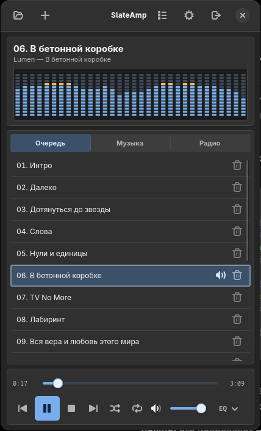

# SlateAmp 0.9 — equalizer & visualizations

- EQ preset names now persist after restart; older gain-only settings are migrated.
- Six additional EQ presets: Pop, Electronic, Jazz, Classical, Acoustic, and Treble Boost (six new presets).
- Manually changing any EQ slider switches the selector to **Custom** without losing the new gain values.
- Selecting a preset writes settings once rather than saving 10 times.
- Fixed the double hover/focus decoration on the EQ menu button. The inner button has the only visible focus ring.
- Two new **audio-reactive** visualizations: **Mirror** and **Radial spectrum**. Both are driven by the existing GStreamer spectrum data, not fake animation.
- All themes, adaptive layouts, radio, library, MPRIS, icons and installer retained from v0.8.

Unpack this archive, install the dependencies listed below, and run `./install.sh`.
The source archive has not been compiled or tested with a running GTK display in this environment.

---

# SlateAmp 0.8 — responsive layout experiment

The first experimental adaptive layout for SlateAmp (Rust + GTK4 + libadwaita + GStreamer).

- **Narrow window (< 880 logical px):** compact vertical player → queue / music / radio → transport.
- **Wide (880–1479 px):** player and transport at left; queue / music / radio at right.
- **Expanded (1480+ px):** adds a playable music-folder sidebar; content stops growing at 1600 px.
- All modes use the same widgets and playback engine. Resize the window to switch layouts.
- Spectrum now spans 45 Hz–12 kHz and analyzes quieter high-frequency content (down to -110 dB); no audio EQ changes.

This is an **experimental source release**. Linux / GNOME / Arch is the primary target. A Rust/GTK build and live desktop test are required before treating it as a verified release.

# SlateAmp

A compact GTK4 music player for Linux, inspired by the classic Winamp.



**Version:** 0.9.0 · **License:** MIT · **Stack:** Rust, GTK4/libadwaita, GStreamer

## Features

- Local audio playback and internet radio; import M3U/M3U8 and PLS playlists.
- A music library built from subfolders of a chosen root directory.
- Queue, saved radio stations, shuffle/repeat and a 10-band equalizer.
- Live audio spectrum with multiple visualizations and customizable themes.
- Russian and English UI, window-size persistence and background playback.
- A standalone libadwaita settings window with grouped appearance, library and playback options. It follows the GNOME light/dark system setting, regardless of the player skin.
- The track list always stays visible; no hidden-list toggle or forced compact/expanded state.
- MPRIS integration for GNOME/media controls; keyboard **Space** toggles play/pause except while typing.

## Install on Arch Linux

Install build and runtime dependencies:

```bash
sudo pacman -S --needed base-devel rust pkgconf gtk4 libadwaita \
  gstreamer gst-plugins-base gst-plugins-good gst-plugins-bad \
  gst-plugins-ugly gst-libav
```

Clone this repository, then run:

```bash
./install.sh
```

The installer builds a release binary and installs the application for the current user:

- `~/.local/bin/slateamp`
- `~/.local/bin/slateampctl`
- a `.desktop` launcher in `$XDG_DATA_HOME/applications` (default `~/.local/share/applications`)
- PNG application icons in the user's hicolor icon theme

No `sudo` is needed for `./install.sh`. Search for **SlateAmp** in GNOME, or use `gio launch ~/.local/share/applications/io.github.eugenek32.SlateAmp.desktop`.

### Build without installing

```bash
cargo build --release
./target/release/slateamp
```

The project has been used on Arch Linux with GNOME. Other distributions may require equivalent GTK4/libadwaita and GStreamer development packages. Automated Linux compilation is configured in `.github/workflows/rust-build.yml`.

## Controls

| Action | Control |
| --- | --- |
| Play / Pause | `Space` (outside text fields) |
| Previous / Next | Transport buttons; MPRIS methods |
| Stop, shuffle, repeat | Transport buttons |
| EQ and presets | EQ menu |
| Manage music folders, radio and UI preferences | In-app controls |

MPRIS bus name: `org.mpris.MediaPlayer2.slateamp`.

Macro keys that target the active player may be routed to a browser instead of SlateAmp. To target this app directly, use:

```bash
~/.local/bin/slateampctl play-pause
~/.local/bin/slateampctl next
~/.local/bin/slateampctl previous
```

To diagnose MPRIS messages, quit all existing instances and launch with:

```bash
SLATEAMP_DEBUG_MPRIS=1 ~/.local/bin/slateamp
```

## Uninstall

```bash
./uninstall.sh
```

Personal settings, stations and library data are retained. Preferences live under `$XDG_CONFIG_HOME/slateamp` (default `~/.config/slateamp`).

## Development

```bash
cargo test
cargo build --release
```

For reproducible application builds, generate and commit `Cargo.lock` once with `cargo generate-lockfile` on a machine with Cargo registry access.

## License

[MIT](LICENSE).
